<p align="center">
  
</p>

<h1 align="center">SyncSwift</h1>

<p align="center">
  <b>Seamless, Ultra-Fast Cross-Platform File Sharing & Real-Time Universal Clipboard Sync</b>
</p>

<p align="center">
  
  
  
  
  
</p>

---

## 🚀 Overview

**SyncSwift** brings the effortless elegance of Apple AirDrop and Universal Clipboard to every platform. Designed with a quiet, flat, ultra-minimalist aesthetic, SyncSwift enables direct high-speed transfers across Android, iOS, Windows, and macOS devices on local networks with zero server latency, as well as secure remote transfers across cellular and external networks.

---

## ✨ Key Features

- **⚡ Direct Local Peer-to-Peer (P2P):** Instant device discovery using mDNS ZeroConf and high-throughput direct TCP streams. Transfers are capped only by your local Wi-Fi speeds.
- **📋 Real-Time Universal Clipboard:** Effortlessly copy text on one device and paste it instantly on another with live bi-directional sync.
- **🌐 Secure Remote Transfers:** Transfer files across different Wi-Fi networks and mobile cellular data via encrypted channels.
- **🔒 Zero-Knowledge & 256-bit Encryption:** All transfer streams and payloads use 256-bit End-to-End Encryption (Curve25519, AES-256-GCM, TLS 1.3). No third party, developer, or intermediate relay can inspect your data.
- **📱 Instant Pairing & QR Connection:** Pair devices in seconds via automated discovery, 6-digit dynamic codes, or high-contrast QR codes with custom camera scanner support.
- **🔔 Background Wake & FCM Notifications:** Wake receiving devices automatically even when the app is in the background or closed.
- **🌍 Full Multi-Language Localization:** Built-in native support for 9 languages:
  - English, Türkçe, Deutsch, Français, Español, Italiano, Português, Русский, العربية.
- **💎 Clean & Modern Aesthetics:** Fluid Compose Multiplatform architecture with curated dark/light modes, adaptive bottom navigation, and subtle micro-animations.

---

## 🛠️ Architecture & Tech Stack

| Layer | Technologies |
|---|---|
| **Core Framework** | Kotlin Multiplatform (KMP), Kotlin Coroutines, Kotlinx Serialization |
| **User Interface** | Jetpack Compose Multiplatform (Material 3, Custom Design System) |
| **Networking & P2P** | mDNS ZeroConf Discovery, Ktor Sockets, TLS 1.3, Custom Framing Engine |
| **Cloud Services** | Supabase (Auth & Device Pairing), Cloudflare R2 (Encrypted Relay Tunnels) |
| **Push & Messaging** | Firebase Cloud Messaging (FCM HTTP v1 via Gateway Gatekeeper) |
| **In-App Purchases** | RevenueCat SDK (Google Play Billing & Apple StoreKit) |
| **Ad Monetization** | Google Mobile Ads (AdMob Adaptive Banner for Free Tier) |

---

## 📂 Project Structure

```
SyncDrop/
├── composeApp/
│   ├── src/
│   │   ├── commonMain/kotlin/net/syncswift/
│   │   │   ├── connection/          # Device pairing & socket connection manager
│   │   │   ├── discovery/           # Cross-platform mDNS ZeroConf discovery
│   │   │   ├── fcm/                 # FCM token management & message handlers
│   │   │   ├── localization/        # Native dictionaries for 9 supported languages
│   │   │   ├── subscription/        # RevenueCat billing & paywall state manager
│   │   │   ├── transfer/            # P2P stream engine, hashing & file storage
│   │   │   ├── ui/                  # Compose UI (Home, Transfers, Account, Modals)
│   │   │   └── SyncSwiftApp.kt      # Main Compose application entry point
│   │   ├── androidMain/             # Android platform bindings, foreground services & camera
│   │   └── iosMain/                 # iOS platform bindings & Darwin socket integrations
│   └── build.gradle.kts
├── public/assets/                   # Vector marks, icons & brand assets
├── logo.png                         # Official high-resolution SyncSwift logo
└── README.md
```

---

## 📥 Building & Running

### Prerequisites

- **JDK 17** or higher
- **Android Studio** Ladybug / Meerkat or IntelliJ IDEA with KMP plugin
- **Android SDK** API Level 34+
- **Xcode 15+** (for iOS builds on macOS)

### Android Release Build

To assemble the optimized, minified release APK:

```bash
# Windows
.\gradlew.bat assembleRelease

# macOS / Linux
./gradlew assembleRelease
```

The output signed APK will be generated at:
```
composeApp/build/outputs/apk/release/composeApp-release.apk
```

---

## 🌐 Official Channels & Support

- **Website:** [syncswift.net](https://syncswift.net)
- **Support Email:** [support@syncswift.net](mailto:support@syncswift.net)

---

<p align="center">
  <sub>© 2026 SyncSwift. All rights reserved.</sub>
</p>
