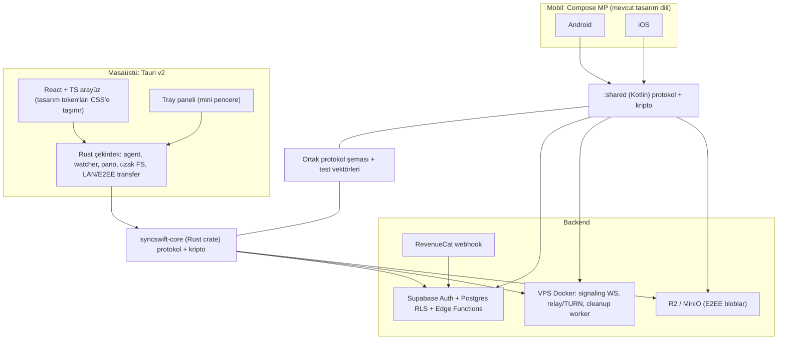

# SyncSwift v2 — Mevcut Durum Analizi ve Fazlı Uygulama Planı

Kaynak şartname: [plan.md](file:///c:/Users/btc/Desktop/SyncSwift/plan.md) (Sürüm 1.0, 22.10.2026)
Sabit kısıtlar: **Auth akışı ve UI'ı birebir korunur** (yalnızca K1 güvenlik düzeltmesi istisnası) · **Tasarım dili / UI-UX korunur** · eski `desktopApp` ve bağlantı katmanı silinir · `main` üzerinde çalışılır.

---

## 0. Onaylanan Kararlar (22.10.2026)

| # | Konu | Karar |
|---|---|---|
| K1 | Service role key istemcide | **Faz 0'da düzeltilecek.** Anahtar Supabase'de yenilenecek, admin işlemleri Edge Function'lara taşınacak, istemcide yalnızca anon key ve kullanıcı JWT'si kalacak. Auth ekranları ve akışı birebir aynı kalacak |
| K2 | Quick Access (kodla anonim paylaşım) | **Kaldırılacak** |
| K3 | Masaüstü teknolojisi | **Tauri v2** (Windows şimdi, macOS sonra): React + TS arayüz ve Rust çekirdek. Agent işleri Rust tarafında yapılacak. **Tray paneli** dahil |
| K5 | Nesne depolama | **MinIO** (VPS üzerinde self-hosted S3 uyumlu depolama: sıfır egress maliyeti, tam kontrol) |
| K6 | Backend / VPS Altyapısı | **Self-Hosted Supabase + MinIO + Signaling/TURN** (Tüm backend altyapısı kullanıcının VPS'inde Docker ile barındırılır. Edge Function yerine yerel PostgreSQL RPC'leri kullanılır) |
| K7 | Şartnamedeki açık kararlar | İlgili faza kadar "KARAR GEREKİYOR" olarak bekletilir |

---

## 1. Mevcut Repo Analizi

### 1.1 Genel yapı

| Alan | Durum |
|---|---|
| Gradle | Tek modül `:composeApp` (KMP: android, iosX64/Arm64/SimArm64, `jvm("desktop")`) |
| Kotlin / Compose | Kotlin 2.1.20, Compose MP 1.7.3, AGP 8.7.3, minSdk 26 |
| Ortak bağımlılıklar | Sadece Compose. **Ktor, kotlinx.serialization, SQLDelight, kripto kütüphanesi yok** |
| Ağ / JSON | Platform başına elle yazılmış HTTP (`HttpURLConnection` / `NSURLSession`) + manuel JSON |
| Desktop | `jvm("desktop")` hedefi tanımlı ama `desktopMain` yok, yani **kırık**. Eski Tauri uygulaması `desktopApp/` |
| Font | Plus Jakarta Sans (variable). Manrope ve Nunito dosyaları da mevcut |
| CI | Sadece iOS TestFlight workflow'u. Test yok |

### 1.2 Katman envanteri

**Korunacak – Auth**
- `Auth.kt`, `AppleAuth*.kt`, `GoogleAuth*.kt`, `SessionManager*.kt`, `SessionEventBus.kt`, `SupabaseClient*.kt`, `AmazonSesMailer*.kt`, `BrevoMailer*.kt`, `ui/auth/**`
- İstisna (K1): `SupabaseClient*.kt` içindeki admin çağrılarının hedefi Edge Function olarak değişir, fonksiyon imzaları ve davranış aynı kalır.

**Korunacak – Tasarım sistemi ve kabuk**
- `ui/theme/SyncSwiftTheme.kt`, `SyncSwiftIcons.kt`, `BrandLogo`, `PlatformFont`
- `ui/components/**`, `Localization.kt` + `localization/*` (9 dil)
- Onboarding, Notifications, Settings, Account, Help ekranları

**Silinecek – Eski bağlantı katmanı**

| Konum | Dosyalar |
|---|---|
| `commonMain` | `connection/`, `discovery/`, `transfer/TransferModels.kt`, `webrtc/`, `quickaccess/`, `clipboard/ClipboardHistoryManager.kt`, `workspace/WorkspaceManager.kt`, `ui/quickaccess/` |
| `androidMain` | `connection/`, `discovery/`, `transfer/LocalSend{Client,Server}.kt`, `transfer/TransferEngine.android.kt`, `clipboard/AndroidClipboardWatcher.kt`, `fcm/FcmSyncManager.kt` + FCM servisindeki bağlantı mantığı |
| `iosMain` | `connection/`, `discovery/`, `transfer/TransferEngine.ios.kt` |
| Kök | `desktopApp/` (eski Tauri v1/React), `supabase_schema.sql` (arşivlenir) |
| Gradle | `composeApp` içindeki `jvm("desktop")` hedefi ve `compose.desktop` bloğu (masaüstü artık Tauri) |

**Yeniden bağlanacak (UI aynı, veri kaynağı yeni)**
- `HomeScreen`, `TransfersScreen`, `ConnectedDevicesScreen`, `ConnectDesktopScreen`, `ConnectedDeviceActionScreen`, `FileDeviceSelectScreen`, `WorkspaceScreen`, `ClipboardHistoryScreen`, `SyncSwiftApp.kt`, `MainActivity.kt`, `MainViewController.kt`, `SubscriptionManager.kt`

### 1.3 Kritik bulgular

> [!CAUTION]
> **Service role key sızıntısı (K1).** Service role key, Supabase'in tüm güvenlik kurallarını (RLS) atlayan **yönetici anahtarı**.
> - Android: `BuildConfig.SUPABASE_SERVICE_ROLE_KEY` APK'ya gömülü. `SupabaseClient.android.kt:13` tüm isteklerde bunu kullanıyor.
> - iOS: `AppConfig.ios.kt:17` içinde anahtar **kaynak kodda açık yazılı** ve git geçmişinde duruyor.
> - Kullanım: `/auth/v1/admin/users` (kullanıcı listeleme, şifre değiştirme, hesap silme) ve tüm tablolar.
> - Tablolarda RLS politikaları `USING (true)`, yani anon key ile bile herkes her şeyi okuyup yazabiliyor.
>
> **Etkisi:** APK/IPA'yı açan biri tüm kullanıcıları listeleyebilir, herhangi bir hesabın şifresini değiştirebilir, hesapları silebilir, tüm verileri okuyabilir.
> **Çözüm:** Anahtar rotate edilir (eskisi geçersiz olur), admin işlemleri `service_role`'ü sadece sunucuda tutan Edge Function'lara taşınır, RLS gerçek kurallarla yazılır.

> [!WARNING]
> **Auth ↔ bağlantı bağımlılığı.** Auth dosyaları eski bağlantı sembollerini kullanıyor (`ConnectionManager.notifyRemoteLogout/sendFcmNotification/ensurePairingCodeActive/activePairingCode/codeRemainingSeconds`, `DeviceDiscoveryManager.getSelfDevice/getLocalIpAddress`, `DiscoveredDevice`, `cleanDeviceDisplayName`, `SyncSwiftFirebaseMessagingService.getSavedToken`). Bunlar için aynı isim ve paketle ince bir **uyumluluk katmanı** (`legacy/`) kurulacak, böylece auth UI kodu değişmeyecek.

> [!WARNING]
> **Güvenlik modeli yok.** Cihaz kimliği, anahtar, PENDING/TRUSTED, E2EE ve imza bulunmuyor. Eşleştirme 6 haneli kod ve IP ile, transfer düz HTTP ile, uzak transfer Supabase polling ile yapılıyor.

**Eski plan ile yeni şartname farkları:** Free/Pro limitleri (3/10 cihaz, 2/50 GB relay, 2/20 GB bulut), TRY fiyat **149,99 / 999,99**, Quick Access kaldırılıyor.

---

## 2. Hedef Mimari



**Temel ilke:** Kotlin ve Rust iki ayrı çekirdek implementasyonu. Uyumluluğu, dilden bağımsız tek bir protokol spesifikasyonu (`docs/protocol/`) ve **paylaşılan test vektörleri** (`tests/vectors/*.json`) garanti eder. Vektörler her iki tarafta da CI'da koşar.

### 2.1 Klasör yapısı

```
SyncSwift/
├─ composeApp/                 # Android + iOS UI (mevcut) + legacy shim
├─ shared/                     # Kotlin KMP çekirdek (android, ios)
│  └─ net/syncswift/core/{devices,crypto,permissions,database,networking}
│     transfer/{protocol,chunks,resume,queue}  sync/ remote/ offline/ vault/ workspace/ clipboard/ billing/
├─ desktopApp/                 # YENİ Tauri v2 (sıfırdan)
│  ├─ src/                     # React + TS (ui/theme tokens, components, screens, tray)
│  └─ src-tauri/
│     ├─ crates/syncswift-core # protokol, kripto, transfer (Rust)
│     ├─ crates/agent          # watcher, clipboard, remote-fs, autostart
│     └─ src/                  # Tauri komutları, tray, pencere yönetimi
├─ backend/
│  ├─ supabase/{migrations,functions,tests}
│  └─ signaling/               # WS signaling + relay servisi (Docker)
├─ infra/                      # docker-compose: signaling, coturn, minio, caddy
├─ docs/{adr,protocol,threat-model}
├─ tests/vectors/              # Kotlin & Rust ortak kripto/protokol vektörleri
└─ iosApp/
```

### 2.2 Teknoloji seçimleri

| İhtiyaç | Kotlin (mobil) | Rust (masaüstü) |
|---|---|---|
| İmza / anlaşma | libsodium (`ionspin` KMP) Ed25519 / X25519 | `ed25519-dalek`, `x25519-dalek` |
| AEAD | XChaCha20-Poly1305 (libsodium) | `chacha20poly1305` (XChaCha) |
| KDF | HKDF-SHA256, Argon2id | `hkdf`, `argon2` |
| Secure storage | Android Keystore / iOS Keychain | Windows DPAPI / Credential Manager (`keyring`) |
| HTTP / WS | Ktor Client | `reqwest`, `tokio-tungstenite` |
| Lokal DB | SQLDelight | `rusqlite` / SQLite |
| LAN keşif | Android NSD / iOS Bonjour | `mdns-sd` |
| Serileştirme | kotlinx.serialization | `serde` (aynı JSON/CBOR şeması) |
| Pano / dosya izleme | OS sınırları dahilinde | `arboard`, `notify` + periyodik tarama |
| Tray / autostart / güncelleme | — | Tauri v2 `tray-icon`, `plugin-autostart`, `plugin-updater`, `plugin-single-instance`, `plugin-notification` |

| Backend | Seçim |
|---|---|
| Signaling + relay | Ktor (JVM) veya Rust (axum) servisi, Docker, VPS'te. ADR-0003'te seçilecek |
| NAT | coturn (STUN/TURN), VPS |
| Depolama | S3 API: R2 (prod) / MinIO (VPS, dev veya alternatif) |
| Admin işlemleri | Supabase Edge Functions (service role yalnızca burada) |

---

## 3. Tasarım Dilini Koruma

**Mobil (Compose):**
- Yalnızca mevcut token'lar (`Night`, `CardSurface`, `InputBg`, `InputBorder`, `Blue`, `Mist`, `Cloud`, `Placeholder`, `PillButton*`, `SuccessGreen`, `ErrorRed`) ve mevcut bileşenler (`PillField`, `MainPill`, `SyncSwiftBottomSheet`, `HeaderControls`, `FormControls`, `BottomNavBar`) kullanılır.
- Mevcut ekran layout'ları değişmez, sadece veri kaynakları değişir. Yeni ekranlar mevcut iskeletten (Header + kart listesi + bottom sheet) türetilir.

**Masaüstü (Tauri / React):**
- `SyncSwiftTheme.kt` token'ları birebir CSS değişkenlerine aktarılır (`--night`, `--card-surface`, `--blue`, … dark/light) ve tipografi ölçeği (22/16/14/12/10 sp → px, letter-spacing) korunur.
- Font Plus Jakarta Sans. Mobildeki pill input, pill buton, bottom sheet ve kart bileşenleri React'te aynı ölçü ve köşe yarıçapıyla yeniden yazılır. Gradient, glow ve abartılı gölge yok (şartname §19).
- `DesktopSidebar` / `DesktopTopBar` Compose bileşenlerinin düzeni referans alınır.
- **Tray paneli:** sistem tepsisine tıklayınca açılan, çerçevesiz küçük pencere. İçeriği: cihaz durumu, son aktarımlar, sürükle-bırak gönderme alanı, pano son öğe, hızlı eylemler (Gönder, Uygulamayı aç, Duraklat).

Ortak kural: her yeni metin 9 dile eklenir. Masaüstünde aynı anahtar setiyle `i18n/` kullanılır.

---

## 4. Fazlı Plan (şartname §29 ile hizalı)

Her faz sonunda ADR, migration, API kontratı, testler ve faz raporu üretilir. **Sonraki faza otomatik geçilmez.**

| Faz | Kapsam | Çıkış kriteri |
|---|---|---|
| **0** | Temizlik, K1 güvenlik düzeltmesi, iskelet (`:shared`, yeni Tauri v2 + tray kabuğu, backend/infra iskeleti), CI, ADR, tehdit modeli | Android/iOS mevcut UI ile açılır ve auth aynen çalışır. Tauri penceresi ve tray paneli açılır. İstemcide service role yok. CI yeşil |
| **1** | Cihaz kimliği (Kotlin + Rust), secure storage, `devices` v2 + RLS, auth sonrası cihaz kaydı | Anahtar yaşam döngüsü testleri, çapraz vektörler |
| **2** | Pairing durum makinesi, QR/SAS, onay ekranları (mobil + masaüstü), izinler, revoke | Onay/ret/iptal/race testleri |
| **3** | Kripto: manifest, chunk AEAD, DEK sarma, kurtarma anahtarı | Kotlin ↔ Rust test vektörleri |
| **4** | LAN keşif + E2EE transfer motoru (her iki çekirdek), kuyruk/resume, UI bağlama | Büyük dosya, resume, iptal (Android ↔ Windows) |
| **5** | Signaling, NAT traversal, relay fallback, relay kota ölçümü | Gerçek ağ senaryoları |
| **6** | Geçici E2EE bulut (7 gün TTL), teslim onayı, cleanup | Offline teslim, çoklu alıcı |
| **7** | Kişisel kasa, 2/20 GB kota, anahtar yedekleme, sürüm/çöp kutusu | Kurtarma, kalıcı sürüm |
| **8** | Windows Agent (Rust): folder watcher, sync rules, autostart, tray entegrasyonu | Tek/çift yön, delete-off |
| **9** | Uzak dosya yöneticisi (Free salt-okunur / Pro tam), canonical path, symlink/junction koruması | Path traversal, read/write, çöp kutusu |
| **10** | Pano (metin/URL/görsel), geçmiş (5 öğe / 7 gün), offline pin, OS entegrasyonları | OS kısıtları ve fallback |
| **11** | Ortak alan (1 alan / 5 üye, roller, görünürlük, anahtar rotasyonu) | Üye çıkarma ve rotasyon |
| **12** | RevenueCat (`pro`, `default`, `pro_monthly/pro_yearly`), webhook, kota enforcement, paywall | Restore/refund/expiration |
| **13** | Güvenlik incelemesi, performans, imzalı kurulum (MSI/NSIS), beta, mağaza | Release gate |

### 4.1 Faz 0 ayrıntısı

1. **Snapshot commit:** Mevcut değişiklikler "pre-v2 snapshot" commit'i olarak alınır.
2. **Silme:** eski `desktopApp/`, eski bağlantı katmanı, Quick Access, `jvm("desktop")` hedefi. `supabase_schema.sql` → `backend/supabase/legacy/`.
3. **Uyumluluk katmanı (`legacy/`):** Auth'un kullandığı semboller aynı imzalarla kalır.
4. **UI geçici bağlama:** Etkilenen ekranlar empty-state ViewModel'lere bağlanır. Görsel aynı kalır.
5. **K1 güvenlik düzeltmesi:**
   - `backend/supabase/functions/auth-admin` (check-user, get-provider, update-password, update-profile, delete-account…). Her biri JWT ya da OTP doğrulaması yapar.
   - `SupabaseClient.android/ios.kt` admin çağrılarını Edge Function'a yönlendirir (imzalar ve davranış aynı).
   - `build.gradle.kts` ve `AppConfig.ios.kt` içinden service role kaldırılır.
   - Mevcut tablolar için gerçek RLS migration'ı.
   - **Kullanıcı eylemi:** Supabase panelinden JWT secret / service role rotate edilecek.
6. **`:shared` modülü** + bağımlılıklar (Ktor, serialization, SQLDelight, libsodium, coroutines).
7. **Yeni Tauri v2 kabuğu:**
   - `npm create tauri-app` (React + TS, Vite) ve Rust workspace (`syncswift-core`, `agent`).
   - Tasarım token'ları CSS'e, Plus Jakarta Sans ve temel bileşenler (PillField, MainPill, Sheet, Card, Sidebar, TopBar).
   - Tray ikonu ve tray paneli penceresi, single-instance, autostart iskeleti.
   - Masaüstü giriş ekranı: aynı Supabase Auth (e-posta OTP, Google ve Apple için sistem tarayıcısı ile deep link).
8. **Backend/infra iskeleti:** `infra/docker-compose.yml` (signaling placeholder, coturn, minio, caddy).
9. **Protokol ve vektör iskeleti:** `docs/protocol/v1.md`, `tests/vectors/`.
10. **CI:** Android assemble, `:shared` testleri, `cargo test` + `tauri build --debug` (Windows runner), Supabase migration lint.
11. **Dokümanlar:** ADR-0001 mimari, ADR-0002 Tauri masaüstü, threat model, `.env.example`.

---

## 5. Açık Kararlar (ilgili fazda sorulacak)

- Ortak alanda 5 üyeye sahip dahil mi? (Faz 11)
- Offline pin kotası 5 GB mı, kullanıcı değiştirebilir mi? (Faz 10)
- Görsel pano üst sınırı 10 MB mı? (Faz 10)
- Çöp kutusu saklama süresi ve kotadan düşme politikası (Faz 7)
- Yıllık planda relay 50 GB aylık dilimlerle mi yenilenecek? (Faz 12)
- Signaling servisi Ktor mu Rust/axum mu? (Faz 5, ADR-0003)
- macOS Tauri yayın zamanı (Faz 13 sonrası)
